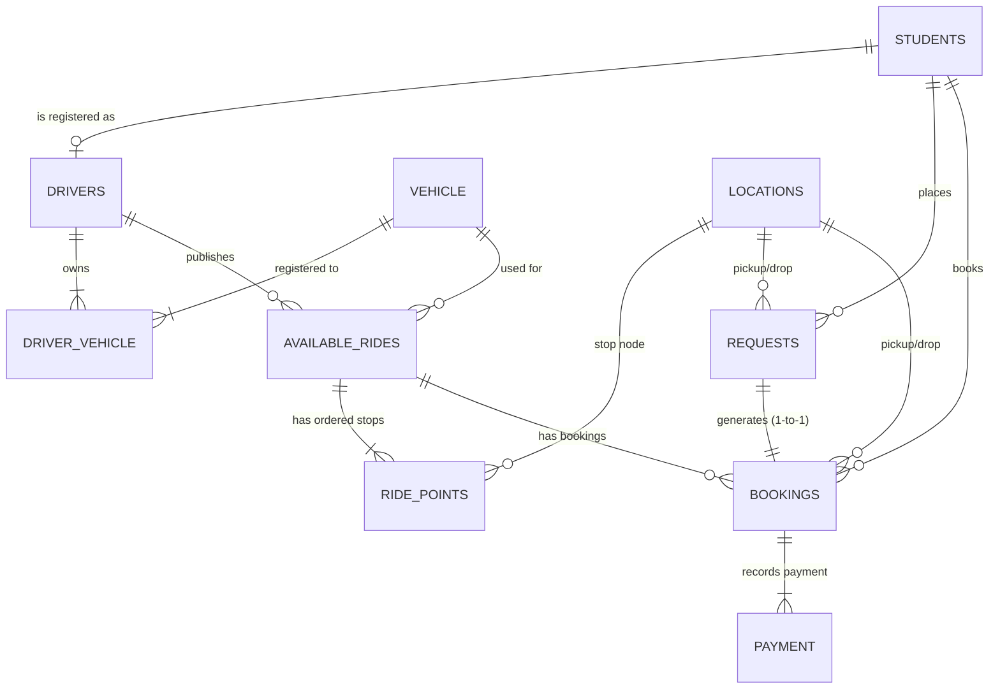

# CampusConnect: Student Mobility & Ride-Sharing System
**DBMS Course Project & Full-Stack Web Application**

CampusConnect is a three-tier web application built strictly following the *Student Mobility & Ride-Sharing System Blueprint*. It allows campus students to discover rides along matching routes, book seats, share commute costs, and publish rides as registered student-drivers, with strict ACID transactions, relational integrity constraints, triggers, and comprehensive views.

---

## 🔑 Pre-Decided Credentials & Demo Accounts

The project includes pre-configured, pre-seeded accounts for demonstrating multi-user interaction:

| Role | Name | Email | Password | Purpose |
| :--- | :--- | :--- | :--- | :--- |
| **System Admin** | Admin User | `admin@campusconnect.edu` | `admin123` | **Pre-decided Admin**: Add campus nodes/locations, view all 10 DBMS tables, inspect views, run SQL queries & reports |
| **Student (Passenger 1)** | Rahul Sharma | `passenger@campusconnect.edu` | `password123` | Find & book rides, view personal bookings, cancel bookings |
| **Student (Passenger 2)** | Riya Patel | `riya@campusconnect.edu` | `password123` | Second student to demonstrate real-time cross-account seat reflections |
| **Driver (Student)** | Arjun Verma | `driver@campusconnect.edu` | `password123` | Registered student-driver with vehicle (Honda City `DL-01-AB-1234`), publishes rides with ordered stops & fares, views ride manifest |
| **Driver 2 (Student)** | Kavita Rao | `driver2@campusconnect.edu` | `password123` | Second registered driver with Swift `DL-04-CD-5678` |

*(Note: In the login page, you can use the **1-Click Quick Demo Autofill** buttons to instantly fill credentials for any of these accounts!)*

---

## 🚀 Quick Start Instructions

### 1. Activate Environment & Run
The project comes with a Python virtual environment ready to run out of the box:

```bash
# Open terminal in project directory
cd /Users/bhasinaryan921/Desktop/uber

# Activate virtual environment
source .venv/bin/activate

# Start the Flask Web Server
python app.py
```

Open your browser and navigate to: **`http://localhost:5050`**

---

## 🎯 Live Presentation Walkthrough (Starts with 0 Published Rides)

The database starts clean with **0 published rides and 0 bookings**, but with all accounts, driver vehicles, and campus locations pre-configured so you can publish live:

1. **Step 1 — Show Student View (Initially Empty)**:
   - Log in as Passenger (`passenger@campusconnect.edu` / `password123` or `riya@campusconnect.edu`).
   - Notice that the **Available Rides** section shows *"No matching rides available at this time"* because no driver has published yet.
2. **Step 2 — Driver Publishes a Route Live**:
   - In another browser tab/window, log in as Driver (`driver@campusconnect.edu` / `password123`).
   - In the **Publish a New Ride** form:
     - Vehicle: *Honda City (DL-01-AB-1234)*
     - Set departure time & fare (e.g., ₹50).
     - Start Point: *North Campus Gate 1*.
     - Click **"+ Add Intermediate Stop"** $\rightarrow$ select *Boys Hostel Block A* or *Tech Block*.
     - Final Destination: *University Metro Station*.
   - Click **"Publish Ride to Campus"**.
3. **Step 3 — Passenger Finds & Books the Ride**:
   - Switch back to the Student Passenger window (no manual reload needed).
   - The newly published ride immediately appears with its ordered route stops!
   - Select Pickup and Drop stops $\rightarrow$ click **"Book Seat"**.
   - Capacity decrements dynamically, booking is confirmed, and simulated payment is recorded.
4. **Step 4 — Driver Ends the Ride**:
   - In the Driver View, the passenger appears in the **Booked Passenger Manifest**.
   - Click **"End / Complete Ride"** to conclude the trip.
5. **Step 5 — Admin View Demonstration**:
   - Log in as Admin (`admin@campusconnect.edu` / `admin123`).
   - Show all 10 live DBMS tables, views, and analytical reports.

---

## 🗄️ Relational DBMS Architecture (10 Tables)

The system adheres strictly to the blueprint schema with InnoDB/SQLite integrity constraints:



### Table Specifications:
1. `students`: `student_id` (PK, AI), `first_name`, `last_name`, `phone_number` (UNIQUE), `email` (UNIQUE), `password_hash`, `role`, `current_mode`, `created_at`.
2. `drivers`: `student_id` (PK & FK $\rightarrow$ students), `licence_id` (UNIQUE), `licence_expiry_date`, `upi_id`.
3. `vehicle`: `vehicle_number` (PK), `type`, `name`, `colour`, `year_of_manufacture`, `capacity` (CHECK > 0).
4. `driver_vehicle`: `student_id` (FK), `vehicle_number` (FK), Composite PK.
5. `locations`: `location_id` (PK, AI), `name` (UNIQUE), `latitude`, `longitude`.
6. `available_rides`: `ride_id` (PK, AI), `driver_id` (FK), `vehicle_number` (FK), `departure_time`, `total_capacity`, `remaining_capacity`, `fare_per_passenger`, `status`, CHECK (remaining_capacity BETWEEN 0 AND total_capacity).
7. `ride_points`: `ride_id` (FK), `sequence_no`, `location_id` (FK), Composite PK (`ride_id`, `sequence_no`).
8. `requests`: `request_id` (PK, AI), `customer_id` (FK), `pickup_location_id` (FK), `drop_location_id` (FK), `schedule_time`, `status`.
9. `bookings`: `booking_id` (PK, AI), `request_id` (FK, UNIQUE), `customer_id` (FK), `ride_id` (FK), `pickup_location_id` (FK), `drop_location_id` (FK), `booking_time`, `status`, `fare` (CHECK $\ge$ 0).
10. `payment`: `payment_id` (PK, AI), `booking_id` (FK), `payment_date`, `amount`, `status`, `method`.

---

## ⚙️ DBMS Concepts Implemented

- **Triggers**:
  - `trg_booking_capacity_decrement`: Automatically reduces `remaining_capacity` when a booking is confirmed.
  - `trg_booking_capacity_restore`: Automatically increments `remaining_capacity` by 1 when booking status changes from `CONFIRMED` to `CANCELLED`.
  - `trg_check_driver_licence`: Prevents publishing rides if the driver's licence has expired.
- **Views**:
  - `confirmed_bookings_view`: Filtered view of confirmed bookings with pickup/drop locations and fares.
  - `published_rides_view`: Filtered view of published rides with seats remaining > 0.
- **Transactions & ACID**:
  - All booking and cancellation flows run inside strict atomic transaction blocks (`START TRANSACTION` / `COMMIT` / `ROLLBACK`).
- **MySQL 8.x DDL Scripts**:
  All standard SQL files are located in `database/`:
  - `schema.sql`: Full DDL with InnoDB foreign keys and constraints.
  - `seed.sql`: Realistic campus seed records.
  - `views.sql`: MySQL view definitions.
  - `triggers.sql`: MySQL trigger definitions.
  - `reports.sql`: 7 analytical evaluation queries.

---

## 🧪 Automated Testing

To run the automated test suite verifying all DBMS rules, triggers, constraints, and views:

```bash
source .venv/bin/activate
python test_system.py
```
*(All 7 comprehensive tests pass 100%).*
