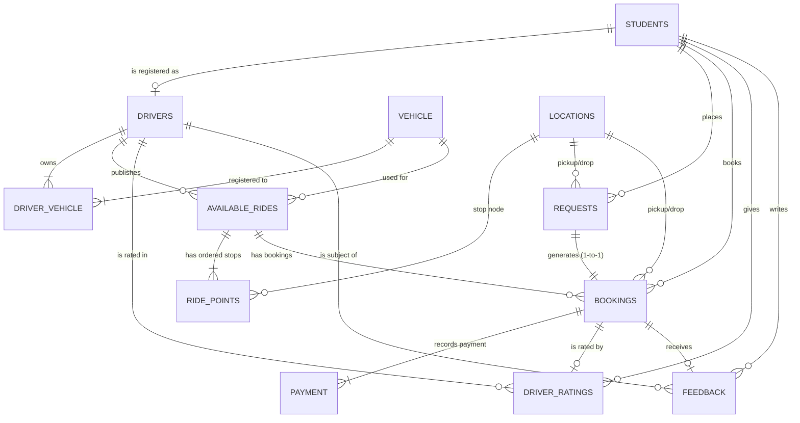

# CampusConnect: Student Mobility & Ride-Sharing System
**DBMS Course Project & Full-Stack Web Application**

CampusConnect is a three-tier web application built strictly following the *Student Mobility & Ride-Sharing System Blueprint*. It allows campus students to discover rides along matching routes, book seats, share commute costs, and publish rides as registered student-drivers, with strict ACID transactions, relational integrity constraints, triggers, and comprehensive views.

---

## 🔑 Pre-Decided Credentials & Demo Accounts

The project includes pre-configured, pre-seeded accounts for demonstrating multi-user interaction:

| Role | Name | Email | Password | Purpose |
| :--- | :--- | :--- | :--- | :--- |
| **System Admin** | Admin User | `admin@campusconnect.edu` | `admin123` | **Pre-decided Admin**: Add campus nodes/locations, view all 12 DBMS tables, inspect views, run SQL queries & reports |
| **Student (Passenger 1)** | Rahul Sharma | `passenger@campusconnect.edu` | `password123` | Find & book rides, view personal bookings, cancel bookings |
| **Student (Passenger 2)** | Riya Patel | `riya@campusconnect.edu` | `password123` | Second student to demonstrate real-time cross-account seat reflections |
| **Driver (Student)** | Arjun Verma | `driver@campusconnect.edu` | `password123` | Registered student-driver with vehicle (Honda City `DL-01-AB-1234`), publishes rides with ordered stops & fares, views ride manifest |
| **Driver 2 (Student)** | Kavita Rao | `driver2@campusconnect.edu` | `password123` | Second registered driver with Swift `DL-04-CD-5678` |

*(Note: In the login page, you can use the **1-Click Quick Demo Autofill** buttons to instantly fill credentials for any of these accounts!)*

---

## 🚀 Quick Start (One-Click Run)

Install [Python 3.8+](https://www.python.org/downloads/) once, then **double-click** the launcher for your system:

| System | Double-click this file |
| :--- | :--- |
| Windows | `Run CampusConnect.bat` |
| macOS | `Run CampusConnect.command` (first time: right-click → Open) |
| Linux | run `./run.sh` in a terminal |

The first run creates a `.venv` and installs Flask automatically (internet needed once). After that it starts the server and opens **`http://localhost:5050`** in your browser. Press `Ctrl+C` or close the window to stop. If port 5050 is busy, the next free port is used and shown in the window.

*Manual alternative:* `python launcher.py` (or `python launcher.py --no-venv` to use your installed Python).

---

## 🎯 Live Presentation Walkthrough (Starts with 0 Published Rides)

The database starts clean with **0 published rides and 0 bookings**, but with all accounts, driver vehicles, and campus locations pre-configured so you can publish live:

1. **Step 1 — Show Student View (Initially Empty)**:
   - Log in as Passenger (`passenger@campusconnect.edu` / `password123` or `riya@campusconnect.edu`).
   - Notice that the **Available Rides** section shows *"No matching rides available at this time"* because no driver has published yet.
2. **Step 2 — Driver Publishes a Route Live**:
   - In another browser tab/window, log in as Driver (`driver@campusconnect.edu` / `password123`).
   - In the **Publish a New Ride** form:
     - Vehicle: *Honda City (DL-01-AB-1234)*
     - Set departure time & fare (e.g., ₹50).
     - Start Point: *North Campus Gate 1*.
     - Click **"+ Add Intermediate Stop"** $\rightarrow$ select *Boys Hostel Block A* or *Tech Block*.
     - Final Destination: *University Metro Station*.
   - Click **"Publish Ride to Campus"**.
3. **Step 3 — Passenger Finds & Books the Ride**:
   - Switch back to the Student Passenger window (no manual reload needed).
   - The newly published ride immediately appears with its ordered route stops!
   - Select Pickup and Drop stops $\rightarrow$ click **"Book Seat"**.
   - Capacity decrements dynamically, booking is confirmed, and simulated payment is recorded.
4. **Step 4 — Driver Ends the Ride**:
   - In the Driver View, the passenger appears in the **Booked Passenger Manifest**.
   - Click **"End / Complete Ride"** to conclude the trip.
5. **Step 5 — Passenger Rates the Driver**:
   - Back in the Student window, the completed booking now shows a **Rate / Feedback** form.
   - Pick 1–5 stars, a feedback category and comments, then click **Submit Review**. Rows are saved to `driver_ratings` and `feedback`.
   - The driver sees the review under **My Ratings & Feedback**.
6. **Step 6 — Admin View Demonstration**:
   - Log in as Admin (`admin@campusconnect.edu` / `admin123`).
   - Show all 12 live DBMS tables, views, and analytical reports.

---

## 🗄️ Relational DBMS Architecture (12 Tables)

The system adheres strictly to the blueprint schema with InnoDB/SQLite integrity constraints:



### Table Specifications:
1. `students`: `student_id` (PK, AI), `first_name`, `last_name`, `phone_number` (UNIQUE), `email` (UNIQUE), `password_hash`, `role`, `current_mode`, `created_at`.
2. `drivers`: `student_id` (PK & FK $\rightarrow$ students), `licence_id` (UNIQUE), `licence_expiry_date`, `upi_id`.
3. `vehicle`: `vehicle_number` (PK), `type`, `name`, `colour`, `year_of_manufacture`, `capacity` (CHECK > 0).
4. `driver_vehicle`: `student_id` (FK), `vehicle_number` (FK), Composite PK.
5. `locations`: `location_id` (PK, AI), `name` (UNIQUE), `latitude`, `longitude`.
6. `available_rides`: `ride_id` (PK, AI), `driver_id` (FK), `vehicle_number` (FK), `departure_time`, `total_capacity`, `remaining_capacity`, `fare_per_passenger`, `status`, CHECK (remaining_capacity BETWEEN 0 AND total_capacity).
7. `ride_points`: `ride_id` (FK), `sequence_no`, `location_id` (FK), Composite PK (`ride_id`, `sequence_no`).
8. `requests`: `request_id` (PK, AI), `customer_id` (FK), `pickup_location_id` (FK), `drop_location_id` (FK), `schedule_time`, `status`.
9. `bookings`: `booking_id` (PK, AI), `request_id` (FK, UNIQUE), `customer_id` (FK), `ride_id` (FK), `pickup_location_id` (FK), `drop_location_id` (FK), `booking_time`, `status`, `fare` (CHECK $\ge$ 0).
10. `payment`: `payment_id` (PK, AI), `booking_id` (FK), `payment_date`, `amount`, `status`, `method`.
11. `driver_ratings`: `rating_id` (PK, AI), `booking_id` (FK, UNIQUE), `driver_id` (FK $\rightarrow$ drivers), `customer_id` (FK $\rightarrow$ students), `rating` (CHECK 1-5), `rated_at`.
12. `feedback`: `feedback_id` (PK, AI), `booking_id` (FK, UNIQUE), `driver_id` (FK $\rightarrow$ drivers), `customer_id` (FK $\rightarrow$ students), `category` (CHECK in GENERAL/PUNCTUALITY/SAFETY/VEHICLE/BEHAVIOUR/PAYMENT), `comments` (non-empty), `created_at`.

Both new tables hang off `bookings`: one rating and one feedback entry per booking, allowed only once the booking is `COMPLETED`.

---

## ⚙️ DBMS Concepts Implemented

- **Triggers**:
  - `trg_booking_capacity_decrement`: Automatically reduces `remaining_capacity` when a booking is confirmed.
  - `trg_booking_capacity_restore`: Automatically increments `remaining_capacity` by 1 when booking status changes from `CONFIRMED` to `CANCELLED`.
  - `trg_check_driver_licence`: Prevents publishing rides if the driver's licence has expired.
  - `trg_validate_driver_ratings` / `trg_validate_feedback`: Reject a rating or feedback unless the booking is `COMPLETED`, belongs to that customer, and the driver matches the ride's driver.
- **Views**:
  - `confirmed_bookings_view`: Filtered view of confirmed bookings with pickup/drop locations and fares.
  - `published_rides_view`: Filtered view of published rides with seats remaining > 0.
  - `driver_rating_summary_view`: Rating count and average rating per driver.
- **Transactions & ACID**:
  - All booking and cancellation flows run inside strict atomic transaction blocks (`START TRANSACTION` / `COMMIT` / `ROLLBACK`).
- **MySQL 8.x DDL Scripts**:
  All standard SQL files are located in `database/`:
  - `schema.sql`: Full DDL with InnoDB foreign keys and constraints.
  - `seed.sql`: Realistic campus seed records.
  - `views.sql`: MySQL view definitions.
  - `triggers.sql`: MySQL trigger definitions.
  - `reports.sql`: 9 analytical evaluation queries.

---

## 🔒 Validation & Security Notes

- **Booking rules:** pickup/drop must be stops on the ride's route (pickup before drop); departed, completed or full rides cannot be booked. The database also enforces this with a `BEFORE INSERT` trigger and `CHECK` constraints.
- **Driver rules:** a ride can only use the driver's own registered vehicle, cannot exceed that vehicle's seats, and must depart in the future. A vehicle already registered to another driver cannot be claimed.
- **CSRF protection:** every POST form carries a per-session token (`csrf.py`); logout is POST-only.
- **Secret key:** read from the `SECRET_KEY` environment variable, otherwise generated once into a git-ignored `.secret_key` file.
- **Server:** listens on `127.0.0.1` with debug off. Opt in with `FLASK_DEBUG=1` / `HOST=0.0.0.0` only on a trusted network.
- **Admin SQL console:** runs on a read-only connection; `password_hash` is always hidden.
- **Database mode:** SQLite is the fully supported mode. The MySQL scripts are provided for the schema/DBMS coursework but the web app's booking/driver code has not been made MySQL-compatible.
- **Existing databases:** triggers and new tables are upgraded automatically on start. New `CHECK`/`UNIQUE` constraints apply to freshly created databases (use *Reset Demo Data* in the admin view or run `python database/sqlite_init.py`).

---

## 🧪 Automated Testing

To run the automated test suite verifying all DBMS rules, triggers, constraints, and views:

```bash
source .venv/bin/activate
python test_system.py
```
*(All 20 tests pass; each test runs on its own temporary database, so your demo data is never touched.)*
